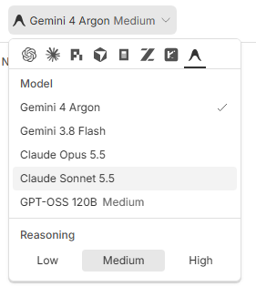
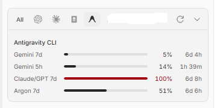

<p align="center">
  
</p>

<h1 align="center">Antigravity CLI for BB</h1>

<p align="center">Use your Antigravity CLI account to code in BB.</p>

<p align="center">
  <a href="#getting-started">Getting started</a> &middot;
  <a href="#modes-and-permissions">Modes & permissions</a> &middot;
  <a href="SECURITY.md">Security</a> &middot;
  <a href="docs/RELEASE.md">Marketplace submission</a>
</p>

An experimental community provider that connects [BB](https://getbb.app) to the [Antigravity CLI](https://antigravity.google/docs/getting-started?tab=cli). Keep your existing CLI sign-in, choose available models, and work with streamed responses and tool approvals inside BB.

**Status:** available in the BB Community marketplace and tested on Windows. macOS and Linux still need validation.

## What you get

- **One provider in BB:** select Antigravity CLI when creating a thread.
- **Live model discovery:** models and reasoning options come from your CLI and account.
- **Plan and Build:** plan a task, then switch back to implementation.
- **Permission controls:** choose Accept edits or Full access.
- **Native skills:** discover your workspace and personal Antigravity skills in BB.
- **Usage & quota limits:** view per-model-group quota windows (`Gemini`, `Claude/GPT`, `Argon`) in BB's sidebar and usage settings.
- **CLI sandbox setting:** request the CLI terminal sandbox for new threads.
- **A settings toggle:** show or hide the provider without editing configuration files.

## Preview

<p align="center">
  
</p>

Choose a model and reasoning level from BB's conversation picker. Available models and options depend on your CLI version and account.

<p align="center">
  
</p>

Check your remaining quota per model group (`Gemini 7d`, `Gemini 5h`, `Claude/GPT 7d`, `Claude/GPT 5h`, `Argon 7d`) and reset countdowns in BB's sidebar usage popover or **Settings -> Usage limits**.

## Getting started

### 1. Prepare the agent host

You need BB 0.48+, Node.js 22+, and a separately installed Antigravity CLI with an eligible account. The Antigravity desktop application alone is insufficient. Your provider's quota and charges still apply.

Run these commands on the machine where the agent will execute:

```sh
agy --version
agy acp --help
```

Sign in if needed:

```sh
agy acp --login
```

The executable must be on that machine's `PATH`. Restart BB after changing `PATH`. Remote agent hosts need their own CLI installation and sign-in.

### 2. Install the plugin

Install from the BB Community marketplace:

```sh
bb plugin install antigravity-cli
```

Alternatively, install **Antigravity CLI** from **Settings -> Plugins** in BB, or install directly from the [GitHub repository](https://github.com/ols-md/bb-plugin-antigravity):

```sh
bb plugin install https://github.com/ols-md/bb-plugin-antigravity
```

To install from a local checkout, run inside the plugin directory:

```sh
npm ci --ignore-scripts
bb plugin install .
```

Review and accept BB's installation prompt. Plugins run with full trust. The GitHub URL tracks the default branch. Release and marketplace information is documented in [docs/RELEASE.md](docs/RELEASE.md).

### 3. Start a thread

Select **Antigravity CLI** in BB's provider picker, choose a model, and send a prompt. The CLI supplies the available models; availability depends on your account and installed version.

## How it works

```text
Your BB thread -> Plugin -> BB's shared ACP bridge -> agy acp -> Antigravity service
```

The plugin starts `agy acp --disable-telemetry` on the agent host. BB's shared [Agent Client Protocol (ACP)](https://agentclientprotocol.com) bridge handles streamed messages, tool updates, approval requests, and session communication. A small adapter exposes the CLI's work mode as Build or Plan in BB.

Authentication stays with the CLI. You do not enter an API key into the plugin or maintain custom-agent JSON.

## Modes and permissions

Planning and permissions are separate controls:

| Control | Choice | Behavior |
| --- | --- | --- |
| Work mode | Plan | Selects the CLI's native Plan mode. Use it to research and outline a task. |
| Work mode | Build | Implement the task using native Accept edits behavior and the selected BB permission policy. |
| Permissions | Accept edits | Uses native Accept edits behavior; remaining ACP approval requests are presented in BB. |
| Permissions | Full access | BB's shared bridge automatically approves ACP permission requests. |

Choose **Build** or **Plan** in the **Mode** selector. Build is the default. The CLI's combined Default / Accept edits / Plan selector is replaced by these two work modes, so editing permissions are no longer repeated there. The separate Plan action is removed. BB's Auto permission mode is unsupported by the shared ACP bridge.

### Terminal sandbox

The plugin inherits the CLI's sandbox settings; it does not add `--sandbox` or force sandboxing off. Antigravity supports an OS-level terminal sandbox on supported systems. Its availability and boundaries depend on your OS, CLI version, and configuration. See [Antigravity's sandbox documentation](https://antigravity.google/docs/sandbox/?tab=cli).

**Full access does not guarantee sandbox containment.** Even with the CLI sandbox enabled, a command can request execution outside it. Full access automatically approves ACP permission requests, potentially including those escape requests. Use Accept edits to retain review of requests forwarded to BB.

Plan is agent behavior, not enforced read-only access. Permission approvals and terminal sandboxing are distinct protections.

## Settings

Open **Settings -> Installed plugins -> Antigravity CLI** and use **Enable Antigravity CLI** to show or hide the provider. Changes apply immediately. Hiding the provider does not stop a running turn. BB's standard installed-plugin switch disables the entire plugin.

The **Request CLI terminal sandbox** setting adds `--sandbox` for new threads. Off means inherit CLI settings, not force sandboxing off. Availability depends on the host OS.

The plugin stores these two boolean preferences. BB and the CLI can retain their normal conversations and diagnostics. Prompts, workspace context, and tool results are processed by Antigravity and its service. Disabling CLI telemetry does not disable service processing or conversation storage. Read [SECURITY.md](SECURITY.md) for the trust and privacy details.

## Limitations

See the [capability comparison](docs/FEATURES.md) for verified features and remaining gaps.

Automatic CLI installation, conversation forking, manual compaction, and native thread archive/rename synchronization are not advertised. The plugin depends on your installed CLI and the shared BB ACP bridge.

## Troubleshooting

| Problem | What to check |
| --- | --- |
| Antigravity is missing | Enable the installed plugin and its **Enable Antigravity CLI** setting. |
| `agy` cannot be found | Install the CLI on the agent host, check `PATH`, and restart BB. |
| Sign-in is required or expired | Run `agy acp --login` on the agent host, then retry. |
| ACP is unavailable | Update the CLI and confirm `agy acp --help` works. |
| Model list is empty | Check CLI sign-in, connectivity, and account eligibility, then refresh providers. |
| Commands run without asking | Check BB's permission selection and the CLI's own permission rules. Full access auto-approves ACP requests. |

When reporting an issue, include BB/CLI versions and a short reproduction. Remove tokens, account details, private paths, and conversation content from logs.

## Development

The test runner requires Node.js 22.18+ or Node.js 24. The SDK dependency is pinned to 0.6.109.

```sh
npm ci --ignore-scripts
npm run check
npm test
npm run build
npm run smoke -- --modes
```

The smoke check creates a real CLI session in a temporary workspace and verifies native Plan/Build transitions without sending a prompt. It refuses incoming tool requests. To send a small test prompt using your account (which can consume quota):

```sh
npm run smoke -- --prompt
```

See [review notes](docs/REVIEW.md) and the [release checklist](docs/RELEASE.md) before publishing. Published npm packages exclude source maps because they can contain local build paths.

## License

[MIT](LICENSE). This project is independent of Google and BB. Their products, services, and dependencies retain their own terms.

The plugin and provider ID is `antigravity-cli`. This is a separate community integration from the marketplace plugin named `antigravity`. Local installations using the earlier ID need to be reinstalled; existing threads retain their original provider ID.

## Native skills

BB discovers skills in workspace `.agents/skills` and legacy `.agent/skills`, and in personal `~/.gemini/antigravity-cli/skills`, `~/.gemini/skills`, and `~/.gemini/config/skills`. Installed CLI plugin skill directories are not yet resolved into BB's picker. See [Antigravity skills](https://antigravity.google/docs/skills).

The provider uses the Antigravity mark in BB's model selector, rendered in one color to follow the theme. The plugin page uses the color mark. See [asset attribution](assets/README.md).
