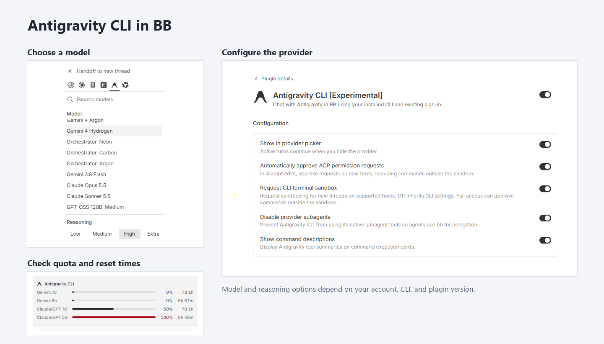

<p align="center">
  
</p>

<h1 align="center">Antigravity CLI Provider for BB</h1>

[](https://github.com/ols-md/bb-plugin-antigravity/releases/latest)
[](https://github.com/ols-md/bb-plugin-antigravity/actions/workflows/checks.yml)
[](LICENSE)

Plan and code in [BB](https://getbb.app) with your installed Google Antigravity CLI and existing sign-in.

**[Install from the BB Community marketplace](https://getbb.app/marketplace/antigravity-cli)** · [Setup](#getting-started) · [Contribute](#development) · [Security](SECURITY.md)

**Experimental.** We tested the plugin on Windows with Antigravity CLI 1.5.18 signed in. We expect it to work on Linux. macOS still needs validation. [Linux test results](docs/FEATURES.md#linux)

- Choose an available model and reasoning level in the BB provider picker.
- Use the CLI's native Plan mode to outline a task. Switch to Build to implement it.
- Review tool approval requests in BB with the default permission settings.
- See quota used and reset times in the usage sidebar and in **Settings → Usage limits** when the CLI reports them.

## Preview



The preview shows example settings. Available models and reasoning levels can depend on your Antigravity account, CLI version, and plugin version. [View the preview at full size](assets/screenshots/marketplace-overview.png?raw=true)

## Getting started

### 1. Prepare the agent host

You need BB 0.48 or later, Node.js 22 or later, and an eligible Antigravity account. Antigravity quota and charges apply.

Install the standalone Antigravity CLI (`agy`) on the machine where the agent runs. If you use a remote agent host, install it there. Use version 1.5.0 or later for ACP. [Google's CLI installation instructions](https://antigravity.google/docs/getting-started?tab=cli)

Check the CLI version and ACP support on the agent host.

```sh
agy --version
agy acp --help
```

If you need to sign in, run this command on the agent host.

```sh
agy acp --login
```

Follow the sign-in prompts. The plugin checks `PATH` first, then the standard CLI install location (`%LOCALAPPDATA%\agy\bin\agy.exe` on Windows or `~/.local/bin/agy` on macOS and Linux).

### 2. Install the plugin

In BB, open **Plugins** from the navigation rail. In the Community marketplace, find **Antigravity CLI Provider [Experimental]** and select **Install**. You can also install it from the command line.

```sh
bb plugin install antigravity-cli
```

To install from the default branch on GitHub, run this command.

```sh
bb plugin install https://github.com/ols-md/bb-plugin-antigravity
```

To install from a local checkout, run these commands in the plugin directory.

```sh
npm ci --ignore-scripts
bb plugin install .
```

Plugins run with full trust. Review BB's installation prompt. If you trust the plugin, accept the prompt. For release and marketplace information, see the [release guide](docs/RELEASE.md).

### 3. Start a thread

1. Select **Antigravity CLI** in BB's provider picker for a new thread.
2. Select an available model. If the model offers reasoning levels, select a level.
3. In the **Mode** selector, select **Build** to implement a task or **Plan** to outline it. See [Modes and permissions](#modes-and-permissions).
4. Send a prompt.

## How it works

```text
Your BB thread -> Plugin -> BB's shared ACP bridge -> agy acp -> Antigravity service
```

The plugin starts `agy acp --disable-telemetry` on the agent host. BB's shared [Agent Client Protocol (ACP)](https://agentclientprotocol.com) bridge handles streamed messages, tool updates, approval requests, and session communication. A small adapter exposes the CLI's work mode as Build or Plan in BB.

Authentication stays with the CLI. You do not enter an API key into the plugin or maintain custom-agent JSON.

## Modes and permissions

Planning and permissions are separate controls:

| Control | Choice | Behavior |
| --- | --- | --- |
| Work mode | Plan | Selects the CLI's native Plan mode. Use it to research and outline a task. |
| Work mode | Build | Implement the task using native Accept edits behavior and the selected BB permission policy. |
| Permissions | Accept edits | Uses native Accept edits behavior; remaining ACP approval requests are presented in BB unless automatic approval is enabled. |
| Permissions | Full access | BB's shared bridge automatically approves ACP permission requests. |

Choose **Build** or **Plan** in the **Mode** selector. Build is the default. The CLI's combined Default / Accept edits / Plan selector is replaced by these two work modes, so editing permissions are no longer repeated there. BB's Auto permission mode is unsupported by the shared ACP bridge.

### Terminal sandbox

By default the plugin inherits the CLI's sandbox settings. Antigravity supports an OS-level terminal sandbox on supported systems. Its availability and boundaries depend on your OS, CLI version, and configuration. See [Antigravity's sandbox documentation](https://antigravity.google/docs/sandbox/?tab=cli).

**Full access does not guarantee sandbox containment.** Even with the CLI sandbox enabled, a command can request execution outside it. Full access automatically approves ACP permission requests, potentially including those escape requests. Use Accept edits with automatic approval off to retain review of requests forwarded to BB.

Plan is agent behavior, not enforced read-only access. Permission approvals and terminal sandboxing are distinct protections.

## Settings

Open **Settings -> Installed plugins -> Antigravity CLI Provider [Experimental]** and use **Show in provider picker** to show or hide the provider. Changes apply immediately. Hiding the provider does not stop a running turn. BB's standard installed-plugin switch disables the entire plugin.

The **Request CLI terminal sandbox** setting adds `--sandbox` for new threads. Off means inherit CLI settings, not force sandboxing off. Availability depends on the host OS.

**Automatically approve ACP permission requests** is off by default. When enabled, the plugin answers Antigravity ACP permission requests automatically in Accept edits mode, including commands requesting execution outside the CLI sandbox. It takes effect on new turns, keeps the selected BB permission mode and direct ACP filesystem restrictions, and does not override a host policy that denies permission escalation. Requests without an allow option and other interactions continue to BB. Full access already auto-approves these requests.

**Disable provider subagents** is off by default. When enabled, the plugin instructs Antigravity CLI not to use its native subagent tools (`invoke_subagent`, `define_subagent`, `manage_subagents`, `send_message`) so agents delegate work through BB threads (`bb thread spawn --parent-self`), and automatically denies native subagent approval prompts (taking precedence over automatic approval).

**Show command descriptions** is on by default. When this setting is on, the plugin trims Antigravity's `toolSummary` and the command line for comparison. If the trimmed description contains text and differs from the trimmed command line, the card shows the description as the title. In this case, if the command line is available, the card shows it as the subtitle.

If the tool sends a request to run a command outside the sandbox, the command card shows the **Outside of sandbox** badge. When **Show command descriptions** is off, the card shows this badge for these requests.

The plugin stores these boolean preferences. BB and the CLI can retain their normal conversations and diagnostics. Prompts, workspace context, and tool results are processed by Antigravity and its service. Disabling CLI telemetry does not disable service processing or conversation storage. Read [SECURITY.md](SECURITY.md) for the trust and privacy details.

## Limitations

See the [capability comparison](docs/FEATURES.md) for verified features and remaining gaps.

Use `/compact` after a conversation turn to reduce its context. BB confirms completion from the new checkpoint in the local Antigravity transcript.

Automatic CLI installation, conversation forking, and native thread archive/rename synchronization are not advertised. The plugin depends on your installed CLI and the shared BB ACP bridge.

## Troubleshooting

| Problem | What to check |
| --- | --- |
| Antigravity is missing | Enable the installed plugin and its **Show in provider picker** setting. |
| `agy` cannot be found | See [Windows CLI recovery](#windows-cli-recovery). Install the standalone CLI on the agent host; the plugin also checks its standard install location. |
| Sign-in is required or expired | Run `agy acp --login` on the agent host, then retry. |
| Provider health reports an old CLI | Run `agy update` on the agent host. Check provider health again. |
| ACP is unavailable | Run `agy acp --help` on the agent host. |
| Model list is empty | Check CLI sign-in, connectivity, and account eligibility, then refresh providers. |
| Commands run without asking | Check automatic approval in plugin settings, BB's permission selection, and the CLI's own permission rules. Full access auto-approves ACP requests. |

When reporting an issue, include BB/CLI versions and a short reproduction. Remove tokens, account details, private paths, and conversation content from logs.

The health diagnostic uses the version reported by the selected CLI. If the version check fails or returns an unrecognized version, BB can still report the CLI as ready. The version check alone cannot confirm ACP startup, sign-in, or feature support.

### Windows CLI recovery

If PowerShell reports **`agy` is not recognized**, check the default installation:

```powershell
Test-Path "$env:LOCALAPPDATA\agy\bin\agy.exe"
```

If it returns `False`, install the standalone CLI using the [official installation instructions](https://antigravity.google/docs/getting-started?tab=cli):

```powershell
irm https://antigravity.google/cli/install.ps1 | iex
```

If it returns `True`, add its directory to the current terminal's PATH and verify:

```powershell
$env:Path += ";$env:LOCALAPPDATA\agy\bin"
agy --version
agy acp --login
```

For future terminals, add `%LOCALAPPDATA%\agy\bin` to your user **Path** in Windows Environment Variables, then reopen PowerShell and restart BB. The plugin fallback also works without this PATH change.

## Development

Contributions are welcome. Choose a starting point for your change.

- **Test a signed-in session on macOS or Linux.** Install the plugin from the marketplace. Sign in to the CLI. In BB, select a model and try both Plan and Build. Remove private data from your logs. Report your OS, BB version, CLI version, and results in [GitHub Issues](https://github.com/ols-md/bb-plugin-antigravity/issues).
- **Improve CLI setup or diagnostics.** Start with [CLI discovery and health checks](cli.ts) and [CLI tests](tests/cli.test.mjs).
- **Improve Plan and Build.** Start with [mode controls](mode-controls.ts) and [mode tests](tests/mode-controls.test.mjs).
- **Improve quota reporting.** Start with [usage reporting](usage.ts) and [usage tests](tests/usage.test.mjs).

Read the [Antigravity contributor guide](.bb/skills/antigravity-contributor/SKILL.md) and the [security checks for contributions](SECURITY.md#public-contribution-and-release-checks). If you suspect a vulnerability, follow the private reporting instructions in [SECURITY.md](SECURITY.md).

### Repository checks

The test runner requires Node.js 22.18+ or Node.js 24. Run these commands from the repository root.

```sh
npm ci --ignore-scripts
npm run check
npm test
npm audit --audit-level=low
npm pack --dry-run --ignore-scripts
```

[GitHub Actions](https://github.com/ols-md/bb-plugin-antigravity/actions/workflows/checks.yml) runs these checks on pull requests and scans Git history for secrets with Gitleaks.

### Local build and CLI smoke checks

If BB is available on your machine, build the plugin locally.

```sh
npm run build
```

If you are signed in to the Antigravity CLI on a trusted machine, run the smoke check.

```sh
npm run smoke -- --modes
```

The smoke check creates a real CLI session in a temporary workspace and verifies native Plan/Build transitions without sending a prompt. It refuses incoming tool requests. To send a small test prompt using your account (which can consume quota):

```sh
npm run smoke -- --prompt
```

See [review notes](docs/REVIEW.md) and the [release checklist](docs/RELEASE.md) before publishing. Published npm packages exclude source maps because they can contain local build paths.

## License

[MIT](LICENSE). This project is independent of Google and BB. Their products, services, and dependencies retain their own terms.

The plugin and provider ID is `antigravity-cli`. This is a separate community integration from the marketplace plugin named `antigravity`. Local installations using the earlier ID need to be reinstalled; existing threads retain their original provider ID.

## Native skills

BB discovers skills in workspace `.agents/skills` and legacy `.agent/skills`, and in personal `~/.gemini/antigravity-cli/skills`, `~/.gemini/skills`, and `~/.gemini/config/skills`. Installed CLI plugin skill directories are not yet resolved into BB's picker. See [Antigravity skills](https://antigravity.google/docs/skills).

The provider uses the Antigravity mark in BB's model selector, rendered in one color to follow the theme. The plugin page uses the color mark. See [asset attribution](assets/README.md).
